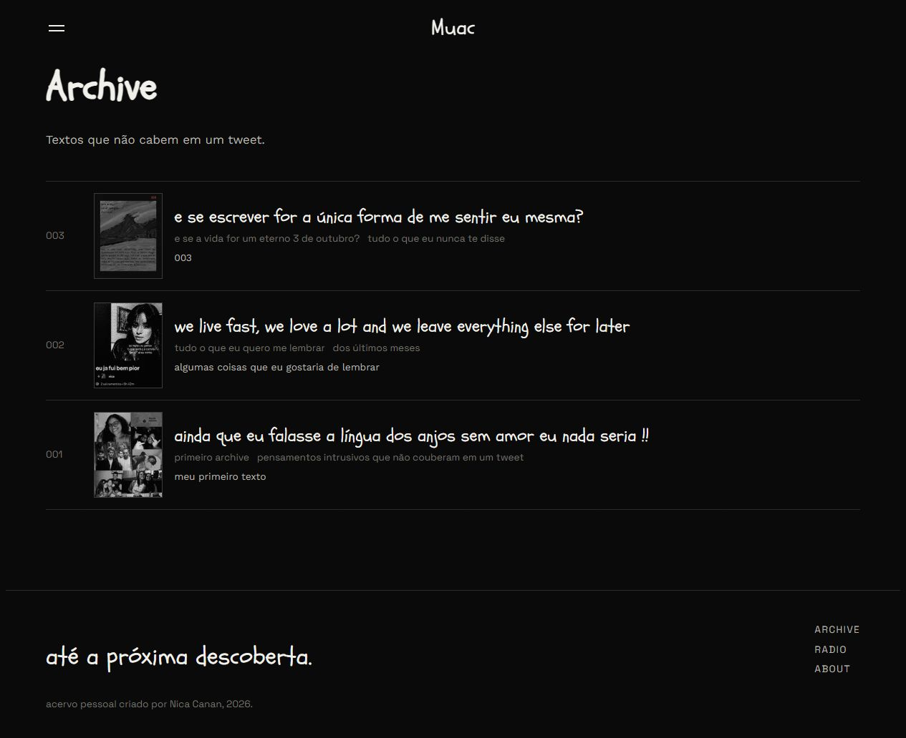

# Muac

**coisas que eu quero lembrar.**

Um acervo pessoal de histórias, música, imagens e descobertas. Um projeto em que explorei como usar inteligência artificial para transformar uma ideia criativa em uma experiência web com identidade própria.

[Visitar o Muac](https://muac.muaclife.workers.dev/) · [Processo com IA](#desenvolvimento-com-ia) · [Arquitetura](docs/arquitetura.md) · [Executar localmente](docs/desenvolvimento.md)



## De onde veio a ideia

Criei o Muac para reunir coisas que eu queria guardar: uma história que merece ser contada, uma música que acompanha uma fase, uma referência que aparece pelo caminho.

Queria dar uma forma digital a esse acervo sem perder o jeito pessoal de um caderno de descobertas. Por isso, conteúdo, aparência e navegação foram pensados juntos. O projeto continua crescendo conforme surgem novas histórias e novas maneiras de organizá-las.

## Uma identidade para o acervo

O visual combina fundo quase preto, texto em tons claros, um acento vermelho e a carpa como elemento recorrente. A tipografia manuscrita aproxima os títulos de uma anotação; a organização editorial dá espaço para ler e explorar.

Schoolbell, Space Grotesk e Work Sans compõem essa linguagem. As fontes são servidas pelo próprio projeto, e os estilos usam CSS Modules e variáveis de cor, espaçamento e tipografia para manter a identidade entre as páginas e o painel.

## Desenvolvimento com IA

A IA participou tanto da exploração visual quanto da implementação. Na evolução registrada neste repositório, usei o Codex para trabalhar sobre o código, discutir soluções e testar mudanças no projeto.

Meu papel foi dar direção ao acervo: o que ele deveria comunicar, quais histórias compartilhar, quais referências faziam sentido e quando uma proposta precisava mudar. A IA ajudou a transformar essa intenção em alternativas de interface e em código que eu pudesse experimentar.

O processo passou por:

1. **Descrever a intenção.** Partir da ideia de memória, descoberta e arquivo pessoal para orientar a experiência.
2. **Experimentar formas.** Ajustar tipografia, contraste, composição, navegação e comportamento das páginas.
3. **Construir e revisar.** Desenvolver componentes, integrar conteúdo e refinar o resultado em sucessivas versões.
4. **Conferir no uso real.** Testar no navegador, investigar falhas e revisar decisões depois da publicação.

O apoio da IA também chegou à infraestrutura: migração do conteúdo que vinha do Notion, criação do editor de artigos e tratamento de problemas no carregamento das imagens. Essa parte exigiu conferência dos dados e testes além da aparência da tela.

O que quero mostrar com o Muac é esse encontro entre direção criativa, experimentação e desenvolvimento assistido por IA. A participação da IA foi extensa e incluiu escrita de código; a escolha do que construir e do que faz sentido para o acervo faz parte da minha autoria e curadoria.

## O que o projeto faz

| Espaço | Experiência |
| --- | --- |
| **Home** | Apresentação visual do acervo e acesso às histórias |
| **Archive** | Artigos com capas, numeração, tags, imagens e texto formatado |
| **Radio** | Curadoria musical com playlists incorporadas do Spotify |
| **About** | Contexto do projeto e de quem está por trás dele |
| **Painel privado** | Editor visual, upload de imagens, rascunhos, prévia e publicação |

O painel também reúne métricas próprias de navegação. O site tem uma tela de manutenção com a mesma identidade visual e recuperação de imagens pelo arquivo original quando a otimização falha.

## Como foi construído

| Camada | Tecnologia |
| --- | --- |
| Interface | Next.js, React, TypeScript e CSS Modules |
| Edição | Tiptap e documentos estruturados em blocos |
| Hospedagem | Cloudflare Workers com OpenNext |
| Conteúdo e métricas | Cloudflare D1, em bancos separados |
| Imagens | Cloudflare KV e Cloudflare Images |
| Acesso administrativo | Cloudflare Access e validação de JWT no servidor |

O conteúdo publicado fica separado dos rascunhos. As imagens têm endereços permanentes, e os dados de produção ficam fora do repositório. O adaptador do Notion permanece no código como parte da transição e do caminho de retorno à versão anterior.

## Explorar o código

```text
app/                  páginas públicas, dashboard e APIs
components/           interface, editor e renderização dos artigos
lib/                  conteúdo, validação, autenticação e analytics
migrations/           esquema das métricas
migrations-content/   esquema dos artigos, imagens e versões
public/               identidade visual, fontes e tela de manutenção
tests/                testes com conteúdo fictício
docs/                 arquitetura, desenvolvimento e prévia visual
```

O [guia de desenvolvimento](docs/desenvolvimento.md) explica como iniciar uma cópia local com bancos vazios, sem usar as credenciais ou o acervo de produção. Há um [exemplo de configuração](wrangler.example.jsonc) para adaptar à sua própria instalação.

```powershell
npm ci
npm test
```

Os testes públicos de documentos usam uma amostra fictícia. Os scripts de conferência da migração dependem de snapshots privados e não incluem esses dados no GitHub.

## Um projeto em construção

O Muac reúne decisões de interface, publicação de conteúdo, armazenamento e operação de um site real. Também registra um aprendizado: uma resposta correta no servidor precisa ser conferida no navegador, e uma mudança visual precisa continuar fazendo sentido para quem vai usar.

O código está disponível para estudo. Textos, fotografias e identidade visual têm autoria própria ou de seus respectivos titulares; a disponibilidade do repositório não concede uma licença de reutilização desses conteúdos.

Criado por [Nicoly Canan](https://github.com/nicolycanan).

**até a próxima descoberta.**
