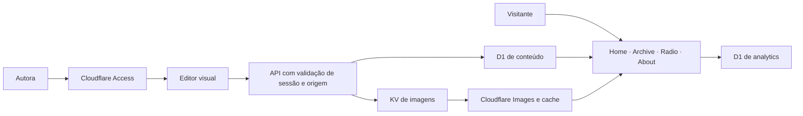

# Arquitetura do Muac

O Muac combina um acervo público com uma área privada de publicação. O repositório guarda a aplicação e os esquemas dos bancos; os artigos, arquivos enviados, rascunhos e eventos reais são dados externos à distribuição do código.

## Conteúdo

Os artigos têm metadados, um estado de publicação e um documento estruturado. Cada bloco é armazenado com sua posição. O renderizador público transforma esse documento em parágrafos, títulos, citações, listas e imagens.

Rascunhos ficam fora das consultas públicas. O salvamento usa uma revisão para detectar edições concorrentes. Os snapshots de versões permitem preservar o que foi salvo, embora a interface não ofereça restauração de versões.

Os endereços existentes dos artigos são mantidos para conservar links e a associação das métricas. O adaptador legado do Notion registra a origem anterior do conteúdo e permite uma transição reversível.

## Imagens

Arquivos são enviados pelo painel e armazenados no KV com identificadores imutáveis. O banco guarda os metadados e o hash do arquivo. As imagens servidas ao público são públicas para quem conhece seu endereço, inclusive as que foram enviadas enquanto um artigo ainda era rascunho.

O Worker encaminha os bytes ao Cloudflare Images, limita as larguras de transformação e armazena as respostas em cache. Se a transformação falhar, há retorno ao original no servidor e recuperação no componente de imagem do navegador.

## Área administrativa

O ambiente publicado usa Cloudflare Access. As operações administrativas validam a assinatura, o emissor, a audiência e a validade do JWT no servidor. Escritas também verificam a origem da requisição.

A dispensa de autenticação para testes exige desenvolvimento, uma variável explícita e um endereço local de loopback. Ela não se aplica ao build de produção.

## Métricas e manutenção

O D1 de métricas é separado do banco de conteúdo. Eventos públicos passam por uma lista permitida e por limite de requisições. As consultas do painel exigem autenticação. O código atual registra endereços IP: quem operar uma instalação deve decidir se essa coleta é necessária, informar seus visitantes e definir retenção adequada.

O modo de manutenção é controlado por configuração e responde com HTTP 503 nas páginas públicas. O painel continua protegido e disponível, e a tela de manutenção usa fontes locais, sem depender do CMS ou das imagens dos artigos.

## Limites e decisões

- KV tem consistência eventual; imagens recém-enviadas podem demorar a aparecer em outra região.
- Franquias gratuitas dependem do uso e dos limites vigentes do provedor.
- Recuperar uma imagem pelo original pode aumentar o volume baixado pelo navegador.
- Os dados e backups de uma instalação não devem ser incluídos no código público.

Os scripts de migração são ferramentas da transição do projeto. Seus snapshots e provas de integridade permanecem privados; não são fixtures públicas nem uma base de demonstração com dados reais.
